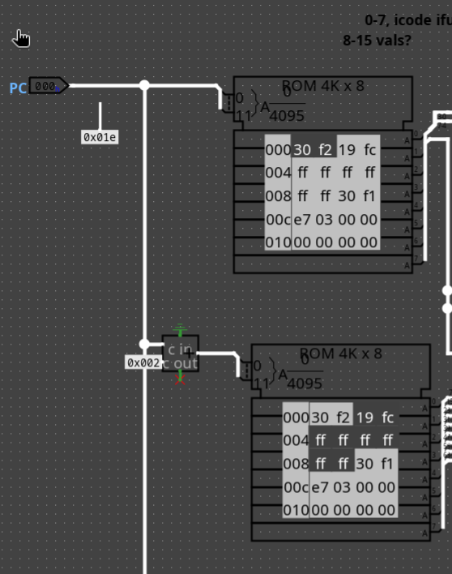

# lab 6

- the fetcher is already working (its currently hooked up to a stepping loop)
- current ROM is [lab 5's problem 1.2](./code-examples/lab5_p1_2.rom)

# yo2mem
- you can compile your own with `yo2mem` or `./mem.sh [my_file.yo]`
- i added the `mem.sh` because for some reason i just didnt have yo2mem

# loading programs
- currently the ROM is split in two places, so you have to Edit Content -> Open file -> (file.rom) on both of them

- this is because the max read is 10 bytes, but logisim can only read up to 8 bytes from one ROM. (using two ROMs then lets you keep the `fetch` in one (technically zero) cycles)

# running
- Ctrl+R to reset states
- Ctrl+T to pulse clock